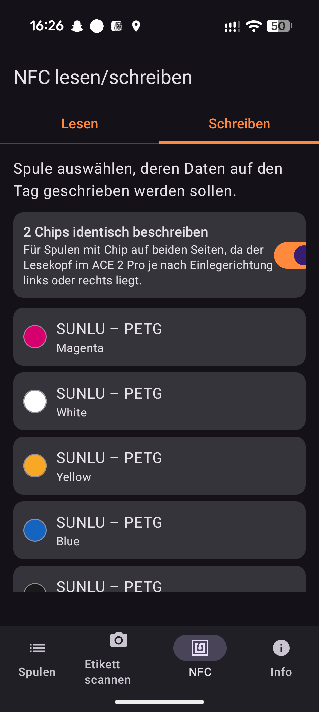
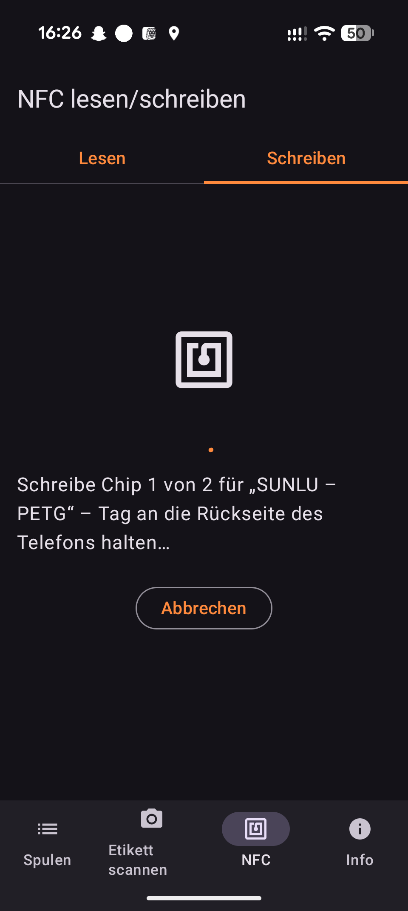
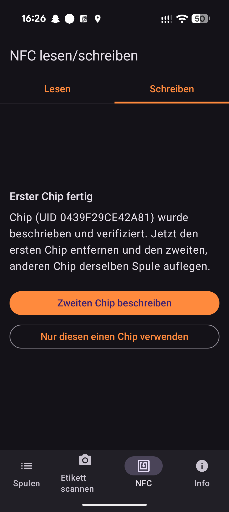
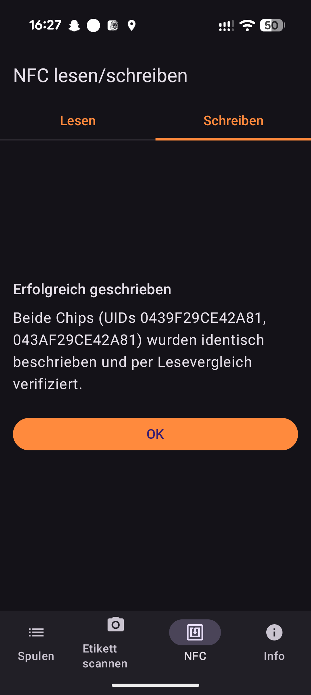

# Filament Manager NFC

Eine Android-App (Kotlin/Jetpack Compose) zur Verwaltung von 3D-Druck-Filamentspulen
für den **Anycubic ACE 2 Pro** – inklusive NFC-Tag-Beschreibung im ACE-2-Pro-kompatiblen
Format, damit der Drucker jede Spule automatisch erkennt und das Restgewicht trackt.

Keine Cloud, kein Account – alle Daten bleiben lokal auf dem Gerät.

## Screenshots

  
  
  
  

## Features

- **Eigene Filament-Datenbank** – Hersteller, Typ/Material, Farbe, Durchmesser,
  Gewicht, Düsen-/Betttemperaturen, Slicer-Einstellungen, Preis und Notizen pro Spule.
- **Lernende Dropdowns** – Hersteller, Materialtypen und Farben werden aus einem
  mitgelieferten Katalog (über 15 Marken, 200+ Farben mit Hex-Werten, 45+ Materialien
  inkl. technischer Kunststoffe und Resin/Pulver) vorgeschlagen und befüllen
  Temperaturfelder automatisch. Eigene, unbekannte Einträge werden genauso gelernt
  wie häufig genutzte.
- **Etikett scannen** – Foto vom Spulen-Etikett aufnehmen, On-Device-OCR (ML Kit)
  erkennt Hersteller, Typ, Farbe, Gewicht, Durchmesser und Temperaturen automatisch
  und füllt das Formular vor. Nicht erkannte Pflichtfelder werden rot markiert.
- **NFC lesen** – Tag auflegen, Daten werden ausgelesen und mit einer vorhandenen
  Spule (per SKU oder Tag-UID) abgeglichen oder als neuer Entwurf übernommen.
- **NFC schreiben** – Spule auswählen, Tag auflegen, Inhalt wird im ACE-2-Pro-Format
  geschrieben und zur Verifikation direkt zurückgelesen. Optional lassen sich zwei
  Tags identisch beschreiben (für Spulen, bei denen der Lesekopf je nach Einlegerichtung
  links oder rechts sitzt).
- **Datenschutz-/Berechtigungs-Onboarding** beim ersten Start, nur Kamera- und
  NFC-Berechtigung werden benötigt.

## NFC-Tag-Format

Grundlage für das Byte-Layout ist das von Dritten offen reverse-engineerte Format
aus [DnG-Crafts/ACE-RFID](https://github.com/DnG-Crafts/ACE-RFID) (Android- und
Windows-Referenzimplementierung), kompatibel mit MIFARE-Ultralight-/NTAG213/215/216-Tags.
Diese App ist eine eigenständige, interoperable Neuentwicklung gegen dieses
dokumentierte Format – keine Übernahme fremder App-Logik oder Assets.

## Build

Der Build läuft **ausschließlich über GitHub Actions**
(`.github/workflows/build-release.yml`) – auf ARM64-Linux-Entwicklungsumgebungen
gibt es kein funktionierendes `aapt2`. Trigger: Tag-Push `v*` oder manuell per
`workflow_dispatch`. Bei vorhandenen Signing-Secrets (`KEYSTORE_BASE64`,
`KEYSTORE_PASSWORD`, `KEY_ALIAS`, `KEY_PASSWORD`) entsteht automatisch ein
signiertes GitHub-Release mit der APK (`AnycubicAceNFC-vX.Y.Z.apk`).

Fertige APKs stehen unter [Releases](../../releases).

## Voraussetzungen

- Android 8.0 (API 26) oder neuer
- Gerät mit NFC
- Anycubic ACE 2 Pro (bzw. kompatible, mit MIFARE-Ultralight-C/NTAG-Tags
  arbeitende Filament-Systeme)

## Mitwirken

Issues und Pull Requests sind willkommen – insbesondere zu weiteren
Hersteller-/Farb-/Materialkatalogen oder zur NFC-Tag-Kompatibilität mit
anderen Druckern.

## Lizenz

MIT License – siehe [LICENSE](LICENSE).
